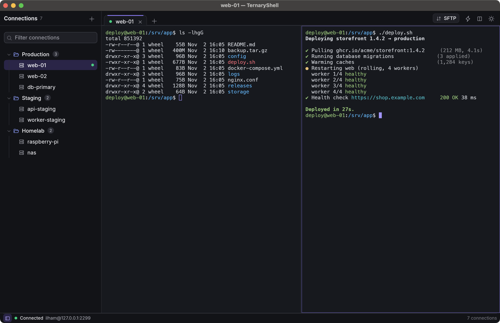
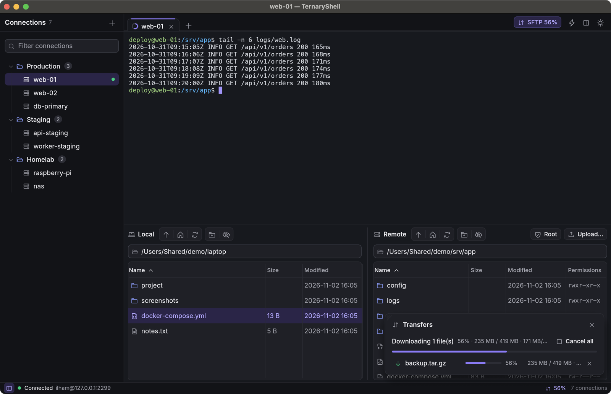
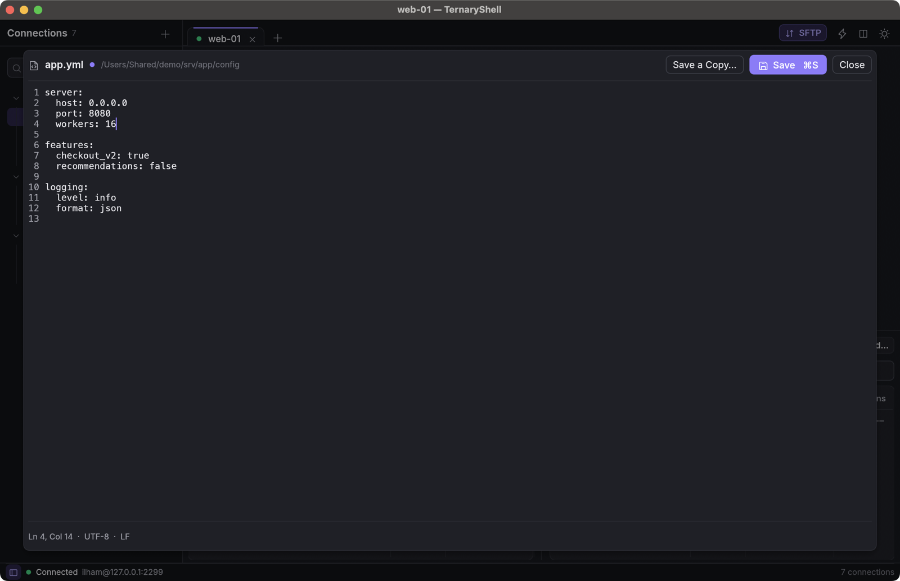

# Peler

**Klien SSH & SFTP ringan untuk macOS, Windows, dan Linux, ditulis sepenuhnya dalam Rust.**

Peler adalah pengganti native untuk klien SSH berbasis Electron seperti Electerm. Bentuknya satu
binary kecil, tanpa Chromium dan tanpa Node.js. Peler terbuka
dalam ±0,1 detik, CPU 0% saat diam, dan memakai sekitar 70 MB memori dengan satu sesi terbuka.

[English](README.md)



## Sorotan

- **Koneksi tersimpan** dalam grup bertingkat, dengan drag and drop, pencarian fuzzy, dan quick connect
  (`⌘K`, `Ctrl+Shift+K` di Windows dan Linux). Password dan passphrase disimpan di keychain sistem
  (Keychain macOS, Credential Manager Windows, Secret Service di Linux), bukan di file Peler. Tombol **Show** di
  Edit Connection menampilkan yang tersimpan.
- **Terminal sungguhan** (alacritty_terminal): warna 24-bit, mouse untuk vim/htop/tmux, IME, CJK,
  dan garis kotak yang digambar presisi.
- **Tab dan split pane** yang memakai satu koneksi SSH bersama.
- **Mendeteksi koneksi yang mati**: setelah jaringan berubah (VPN dinyalakan atau dimatikan, ganti
  Wi-Fi, komputer bangun dari sleep), atau saat ketikan tidak dibalas, Peler mengecek server. Koneksi
  yang tidak menjawab lagi langsung diberi tahu dalam beberapa detik dengan tombol **Reconnect**,
  bukan menggantung.
- **SFTP dua panel**: transfer banyak file sekaligus di latar belakang, dengan progres, kecepatan,
  dan perkiraan sisa waktu. Folder ditransfer rekursif, permission tetap terjaga, dan bisa menjelajah
  sebagai root lewat sudo.
- **Editor bawaan untuk file remote**: ubah config YAML di server, lalu tekan `⌘S` (`Ctrl+S`).
- **Import** dari Electerm dan `~/.ssh/config`. **Export** ke JSON berversi, termasuk password dan
  key, untuk memindahkan semuanya ke komputer lain, di sistem mana pun dari ketiganya.
- **Hati-hati dengan server Anda**: pemeriksaan host key yang ketat (`known_hosts` ter-hash,
  `@revoked`), penyimpanan yang aman, dan transfer yang tidak pernah meninggalkan file setengah jadi.
- **Update otomatis** dari rilis GitHub, dipasang dengan satu klik.
- **macOS, Windows, dan Linux**, masing-masing dengan installer dan pintasannya sendiri.
- Antarmuka bahasa Inggris dan Indonesia, tema terang dan gelap, tanpa telemetri.

## Instalasi

Unduh dari [rilis terbaru](https://github.com/ilhamnadhif/peler/releases/latest):

| Sistem | Unduhan |
| --- | --- |
| macOS 12 Monterey atau lebih baru (Apple Silicon, Intel) | installer satu baris di bawah, `Peler-<versi>.pkg` atau `.dmg` |
| Windows 10 (1809) atau lebih baru, x64 | `Peler-<versi>-windows-x64-setup.exe`, atau `-windows-x64.zip` portable |
| Debian, Ubuntu, Mint, Pop!_OS | `Peler-<versi>-linux-amd64.deb` (`-arm64.deb` di ARM) |
| Fedora, RHEL, Rocky, AlmaLinux, openSUSE | `Peler-<versi>-linux-x86_64.rpm` (`-aarch64.rpm`) |
| Linux apa pun (Arch, Manjaro …) | `Peler-<versi>-linux-x86_64.AppImage` atau `.tar.gz` (`-aarch64` di ARM) |

### macOS

#### Installer satu baris (disarankan)

```sh
curl -fsSL https://raw.githubusercontent.com/ilhamnadhif/peler/master/scripts/install.sh | bash
```

Skrip ini mengunduh rilis terbaru, memasang `Peler.app` ke `/Applications`, lalu membukanya.
Jalankan lagi untuk update. Untuk versi tertentu, tambahkan versinya sebagai argumen:
`… | bash -s -- v1.0.0`.

#### Paket installer atau disk image

Unduh salah satu file ini dari [rilis terbaru](https://github.com/ilhamnadhif/peler/releases/latest):

- **`Peler-<versi>.pkg`**: installer macOS biasa yang memasang Peler ke `/Applications`.
- **`Peler-<versi>.dmg`**: buka, lalu seret **Peler** ke **Applications**.

> **Muncul “Peler” Not Opened / “Apple could not verify…”?** Build rilis belum dinotarisasi
> Apple, jadi macOS memblokir app dan installer yang diunduh lewat browser. Sejak macOS 15, cara
> lama klik kanan → Open sudah tidak bisa. Pilih salah satu cara berikut:
>
> - **Pakai installer satu baris** di atas. File yang diunduh lewat `curl` tidak diblokir.
> - **Izinkan sekali lewat Settings**: klik **Done** di peringatannya, buka **System Settings →
>   Privacy & Security**, gulir ke bagian **Security**, lalu klik **Open Anyway** di samping
>   “Peler was blocked…”. Konfirmasi dengan password, lalu buka Peler (atau file `.pkg`) lagi.
> - **Atau lewat Terminal**, setelah app diseret ke Applications:
>   `xattr -dr com.apple.quarantine /Applications/Peler.app`

#### Homebrew

Setiap rilis menyertakan file cask `peler.rb`:

```sh
curl -fsSLO https://github.com/ilhamnadhif/peler/releases/latest/download/peler.rb
brew install --cask ./peler.rb
xattr -dr com.apple.quarantine /Applications/Peler.app   # selama rilis belum dinotarisasi
```

### Windows

Jalankan **`Peler-<versi>-windows-x64-setup.exe`**. Installer ini memasang Peler untuk user Anda
tanpa hak administrator (pilih **Install for all users** di jendela pertamanya untuk memasang ke
Program Files), menambahkan Peler ke menu Start, dan bisa menaruh `peler` di PATH supaya
`peler web-01` membuka koneksi tersimpan dari terminal. Atau ekstrak **`.zip`** portable di mana
saja lalu jalankan `peler.exe`.

> **Muncul “Windows protected your PC”?** Build-nya belum ditandatangani kode, jadi SmartScreen
> memberi peringatan untuk unduhan baru. Klik **More info**, lalu **Run anyway**.

### Linux

Peler berjalan di X11 dan Wayland dengan OpenGL (renderer software juga cukup) dan butuh glibc
2.28 atau lebih baru (RHEL 8, Debian 10, Ubuntu 18.10, dan yang lebih baru). Password tersimpan
masuk ke Secret Service (GNOME Keyring, KWallet, KeePassXC); dialog file memakai desktop portal.

```sh
sudo apt install ./Peler-<versi>-linux-amd64.deb              # Debian, Ubuntu, Mint, Pop!_OS
sudo dnf install ./Peler-<versi>-linux-x86_64.rpm             # Fedora, RHEL, Rocky, AlmaLinux
sudo zypper install --allow-unsigned-rpm ./Peler-<versi>-linux-x86_64.rpm   # openSUSE
chmod +x Peler-<versi>-linux-x86_64.AppImage && ./Peler-<versi>-linux-x86_64.AppImage
tar -xzf Peler-<versi>-linux-x86_64.tar.gz -C ~/.local --strip-components=1   # lalu jalankan: peler
```

`.tar.gz` diekstrak ke `~/.local` apa adanya (`bin/peler`, entri menu, dan ikonnya).

### Update otomatis

Setiap kali dibuka, Peler memeriksa rilis baru di GitHub. Kalau ada versi baru, jendela update
langsung muncul berisi versi sekarang, versi baru, dan daftar perubahannya. **Install Update** lalu
mengunduh versi terbaru, termasuk yang rilis setelah jendelanya muncul (jadi 1.2.3 langsung ke
versi terbaru, tidak naik satu per satu), memverifikasinya (ukuran dan SHA-256 yang dipublikasikan
GitHub, ditambah pemeriksaan tiap sistem), menutup Peler, lalu memasangnya:

- **macOS**: memeriksa bundle id, versi, dan tanda tangan kode, mengganti aplikasinya, lalu membuka
  versi baru. Kalau Peler dipasang lewat `.pkg` (aplikasinya milik root), macOS meminta password
  administrator.
- **Windows** (dipasang dengan installer): menjalankan installer baru secara diam-diam di atas versi
  yang terpasang, lalu membuka Peler lagi. Instalasi untuk semua user meminta hak administrator.
- **AppImage dan `.tar.gz` di Linux**: memastikan versi baru bisa berjalan, menaruhnya di tempat yang
  lama, lalu membukanya.
- **`.deb`, `.rpm`, dan `.zip` Windows portable** diperbarui dengan mengunduh paket baru dari GitHub
  (jendela update memberi tahu dan membuka halamannya).

**Close** akan menanyakan lagi saat Peler dibuka berikutnya; centang **Don't show again for
version …** untuk melewati versi itu. Selama Peler tetap terbuka, pengecekan diulang setiap 6 jam
dan hanya memunculkan tombol **Update** di toolbar supaya tidak mengganggu. Anda juga bisa memakai
**Check for Updates…** (di menu **Peler** pada macOS, di menu **☰** pada sistem lain), atau
mematikan pengecekan otomatis di **Settings → General**. Pengecekan update adalah satu-satunya
koneksi yang dibuat Peler selain ke server Anda sendiri.

### Uninstall

| Sistem | Cara menghapus |
| --- | --- |
| macOS | `rm -rf /Applications/Peler.app ~/Library/Application\ Support/peler`; password tersimpan adalah item Keychain bernama `peler` |
| Windows | **Settings → Apps → Peler → Uninstall**, lalu hapus `%APPDATA%\peler`; password tersimpan ada di Credential Manager (`peler`) |
| Linux | `sudo apt remove peler` / `sudo dnf remove peler`, atau hapus AppImage atau `~/.local/bin/peler`; lalu `rm -rf ~/.local/share/peler` |

Folder data berisi koneksi, pengaturan, dan known hosts.

## Fitur

### Koneksi

- Isian: nama, host, port, user, grup, tag, catatan, folder awal remote dan lokal, startup command,
  dan algoritma lama per server.
- Login dengan password atau private key. **Paste key-nya** (OpenSSH atau PEM; RSA, ECDSA, atau
  Ed25519, terenkripsi atau tidak): Peler langsung memeriksanya saat di-paste dan menyimpannya di
  keychain sistem. Atau pilih file key di `~/.ssh`.
- **SSH agent**: login dengan key dari agent sistem (`ssh-add`), 1Password, Secretive, Bitwarden,
  GNOME Keyring, atau agent YubiKey; di Windows OpenSSH agent atau Pageant. Agent yang menandatangani; key tidak pernah keluar darinya. Peler menemukan 1Password
  dan Secretive sendiri.
- **Jump host** (`ssh -J`): sambung ke server lewat koneksi tersimpan lain, juga beberapa
  berturut-turut. Setiap hop memeriksa host key-nya sendiri dan login dengan metodenya sendiri.
- **Port forwarding** per koneksi, aktif saat tersambung: lokal (`-L`), remote (`-R`), dan proxy
  SOCKS (`-D`). Status bar menampilkan forward-nya dan memberi tahu kalau port sudah dipakai.
- Grup bertingkat, tertutup saat Peler dibuka; drag and drop untuk mengurutkan atau memindah grup.
- Pencarian fuzzy pada nama, host, user, tag, dan grup. Tekan Enter untuk konek.
- `⌘K` membuka palet perintah. Mengetik `user@host:port` di sana (IPv6 sebagai `[::1]:22`) langsung
  konek tanpa menyimpan koneksi.
- Buka dari Terminal: `open -a Peler --args web-01` atau `--args deploy@10.0.0.5:2222`. Peler hanya
  berjalan satu instance: menjalankannya lagi membuka tab di jendela yang sudah terbuka.

### Terminal

- Emulasi xterm-256color, warna 24-bit, scrollback (default 10.000 baris), layar alternatif,
  bracketed paste, mouse reporting, focus event, dan synchronized output (DEC 2026).
- Seleksi: klik ganda memilih kata, klik tiga kali memilih baris, Option-drag (Alt-drag) memilih blok.
  Copy-on-select tersedia sebagai opsi.
- Garis kotak dan karakter blok digambar sebagai bentuk, jadi garisnya menyambung mulus. Font
  cadangan CJK di-memory-map.
- Komposisi IME, dengan jendela kandidat di posisi kursor.
- Autentikasi password, keyboard-interactive (kode OTP), dan key Ed25519 / ECDSA / RSA, termasuk
  key yang terenkripsi.
- Tab dan split pane (`⌘D`, `⇧⌘D`; `Ctrl+Shift+D`, `Ctrl+Alt+Shift+D`) di atas satu koneksi. Split terbuka di folder remote yang sedang
  aktif, bila shell melaporkannya.
- Enter di pane yang sesinya selesai membuka shell baru di pane itu; `⌘R` (`Ctrl+Shift+R`) menyambung ulang seluruh
  tab dan mempertahankan scrollback.
- Option sebagai Meta di macOS (opsional) dan Alt sebagai Meta di Windows dan Linux, untuk readline dan Emacs. Bekerja dengan layout keyboard apa pun,
  dan hanya aktif saat terminal yang memegang keyboard.
- Quick commands (tombol petir), sembilan skema warna, dan pilihan font (atau file font sendiri).

### SFTP (`⇧⌘F`, `Ctrl+Shift+F`)



- Daftar lokal dan remote berdampingan, di atas koneksi SSH yang sama. Tiap sisi punya dua grup
  tombol (**Naik**, **Beranda**, **Muat ulang**, lalu **Folder baru** dan **Tampilkan file
  tersembunyi**) dan kolom path selebar panel; daftar file memenuhi panel sampai ke bawah.
- **Upload, download, ganti nama, hapus (rekursif), folder baru, chmod.**
- **Banyak file sekaligus**: pilih dengan ⌘-klik (Ctrl-klik), ⇧-klik, atau `⌘A` (`Ctrl+A`) saat
  kursor di atas daftar, lalu drag antar daftar, drop file dari Finder atau Explorer, atau pakai menu
  klik-kanan. **Unggah…** di sisi remote membuka pemilih file sistem.
- **Jelajahi sebagai root (sudo)**: tombol **Root** di sisi remote membuka ulang panel file sebagai
  root lewat `sudo`, untuk melihat dan mentransfer file yang tidak bisa diakses user Anda. Peler
  menanyakan password sudo (atau kosongkan untuk sudo tanpa password); terminal tetap sebagai user
  Anda. Server harus mengizinkan sudo untuk user Anda. Klik **Root** lagi untuk kembali.
- **Transfer yang bisa dipantau**: popup mengambang (bisa disembunyikan atau ditutup) menampilkan
  seluruh batch: file selesai, persen, ukuran, kecepatan, dan sisa waktu, dengan progres tiap baris,
  dan error bila ada. Saat panel disembunyikan, tab menampilkan cincin progres dan tombol SFTP
  menampilkan **SFTP 45%**. Notifikasi muncul saat semuanya selesai atau ada yang gagal.
- File ditulis dengan nama sementara, lalu di-rename ke nama aslinya setelah lengkap. Membatalkan,
  menutup tab, atau quit akan menghapus file setengah jadi, termasuk di server. Ukuran diverifikasi,
  dan permission serta bit executable dipertahankan.
- Ada konfirmasi sebelum file yang sudah ada ditimpa.

### Editor file remote



Klik dua kali file remote (atau klik kanan → **Edit**) untuk mengeditnya langsung:

- Nomor baris, posisi kursor, `⌘S` untuk menyimpan, `Esc` untuk menutup.
- Tab menyisipkan spasi (YAML tidak boleh tab), dan Enter mempertahankan indentasi.
- Line ending CRLF/LF, BOM UTF-8, dan permission file tetap seperti aslinya.
- **Penyimpanan aman**: isi baru ditulis di samping file lalu ditukar, jadi koneksi yang putus tidak
  pernah meninggalkan config setengah tertulis. Symlink dan file milik user lain ditulis langsung
  (in place).
- Ada peringatan bila file diubah orang lain sejak dibuka. Ada konfirmasi sebelum membuang perubahan
  yang belum disimpan, termasuk saat menutup tab atau quit.
- File biner dan file di atas 2 MB tidak dibuka di editor; tersedia tombol Unduh.

### Import dan export

- **Export** semua koneksi, satu grup, atau pilihan tertentu ke JSON berversi (`schema_version`,
  `exported_at`, `groups`, `bookmarks`).
- Password, passphrase, dan key ikut diekspor, termasuk isi file key (`~/.ssh/...`). Semuanya ditulis
  **sebagai teks biasa** di tiap koneksi (`password`, `passphrase`, `private_key`), seperti
  Electerm. Siapa pun yang memegang file itu bisa masuk ke server-server tersebut, jadi simpan
  baik-baik dan hapus setelah diimpor. File hanya bisa dibaca oleh akun user Anda.
- Saat import, di komputer yang punya file key yang sama di path itu, koneksi tetap memakai file
  tersebut; di komputer lain key-nya disimpan di keychain sistem. Export terenkripsi dari Peler 1.2.3 ke bawah
  tetap bisa diimpor: masukkan passphrase-nya di jendela import.
- **Import** menampilkan pratinjau apa yang akan ditambah, diperbarui, atau dilewati. Setiap konflik
  bisa dilewati, ditimpa, atau disimpan keduanya. Import file yang sama dua kali tidak mengubah apa
  pun. Startup command dari file hanya ikut bila Anda mencentangnya.
- File export **Electerm** (koneksi dengan grup bertingkat, password, dan key yang ditempel) dan
  **`~/.ssh/config`** (`Host`, `HostName`, `Port`, `User`, `IdentityFile`, `IdentityAgent`,
  `ProxyJump`, `LocalForward`, `RemoteForward`, `DynamicForward`, `Host *`, negasi, `Include`).

## Pintasan keyboard

Di Windows dan Linux pintasan aplikasi memakai **Ctrl+Shift**, seperti GNOME Terminal dan Windows
Terminal, jadi Ctrl+C, Ctrl+D, Ctrl+R, Ctrl+W, dan Ctrl+huruf lainnya tetap sampai ke shell remote.
Di sana Alt mengirim Meta (Esc +) secara default; di macOS Option melakukannya bila **Use Option as
Meta key** dinyalakan di Pengaturan. Semua perintah juga ada di menu: menu bar di macOS, tombol
**☰** di kanan baris tab di Windows dan Linux.

| Aksi | macOS | Windows dan Linux |
| --- | --- | --- |
| Quick connect / cari koneksi | `⌘K` | `Ctrl+Shift+K` |
| Koneksi baru | `⌘N` | `Ctrl+Shift+N` |
| Tab baru (server yang sama) | `⌘T` | `Ctrl+Shift+T` |
| Tutup pane / tab | `⌘W` | `Ctrl+Shift+W` |
| Pindah tab | `⌘1`–`⌘9`, `⇧⌘[` / `⇧⌘]` | `Alt+1`–`Alt+9`, `Ctrl+Shift+Tab` / `Ctrl+Tab` (atau `Ctrl+PageUp` / `Ctrl+PageDown`) |
| Konek ulang | `⌘R` | `Ctrl+Shift+R` |
| Salin / tempel | `⌘C` / `⌘V` | `Ctrl+Shift+C` / `Ctrl+Shift+V`; di Windows juga `Ctrl+C` saat ada teks terpilih, dan `Ctrl+V` |
| Split kanan / bawah | `⌘D` / `⇧⌘D` | `Ctrl+Shift+D` / `Ctrl+Alt+Shift+D` |
| Pane sebelumnya / berikutnya | `⌘[` / `⌘]` | `Ctrl+Shift+[` / `Ctrl+Shift+]` |
| Sidebar | `⌘B` | `Ctrl+Shift+B` |
| Panel SFTP | `⇧⌘F` | `Ctrl+Shift+F` |
| Ukuran teks | `⌘=` / `⌘-` / `⌘0` | `Ctrl+=` / `Ctrl+-` / `Ctrl+0` |
| Hapus scrollback | `⌥⌘K` | `Ctrl+Shift+L` |
| Gulir riwayat | `⇧PageUp` / `⇧PageDown` / `⇧Home` / `⇧End` | sama |
| Export koneksi | `⇧⌘E` | `Ctrl+Shift+E` |
| Layar penuh | `⌃⌘F` | `F11` |
| Pengaturan | `⌘,` | `Ctrl+,` |
| Keluar | `⌘Q` | `Ctrl+Shift+Q` |
| Simpan (editor file remote) | `⌘S` | `Ctrl+S` |

## Performa

Diukur di MacBook Apple Silicon dengan macOS 14.6, memakai build rilis. Di Windows dan Linux Peler
menggambar dengan OpenGL, yang membuka jendela lebih cepat dan membuat binary lebih kecil daripada
Vulkan atau Direct3D (Windows memakai Direct3D 12 bila OpenGL tidak ada). Binary Linux sekitar
16 MB dan paketnya sekitar 8 MB; di Windows `peler.exe` sekitar 21 MB dan installernya 8 MB.

| | Hasil |
| --- | --- |
| Memori, 1 sesi SSH | 68 MB (physical footprint, seperti di Activity Monitor) |
| Memori, 5 tab SSH | 78 MB |
| Start dingin sampai frame pertama | ±0,1 detik |
| `.app` universal (arm64 + x86_64) | 28 MB (DMG 15 MB) |
| CPU saat diam | 0,0% |
| SFTP 1 GiB ke sshd lokal | upload ±640 MB/s, download ±650–700 MB/s, sha256 diverifikasi |

Scrollback memakan sekitar 24 byte per sel. Lima tab yang masing-masing penuh dengan riwayat
10.000 baris × 120 kolom berjumlah sekitar 210 MB. Kecilkan **Scrollback** di Pengaturan kalau Anda
sering membuka banyak tab yang ramai.

## Keamanan dan data

| Apa | macOS | Windows | Linux |
| --- | --- | --- | --- |
| Folder data: koneksi (`bookmarks.json`), pengaturan, host key tepercaya (`known_hosts`) | `~/Library/Application Support/peler` | `%APPDATA%\peler` | `~/.local/share/peler` |
| Password, passphrase, key hasil import (service `peler`) | Keychain | Credential Manager | Secret Service (GNOME Keyring, KWallet …) |
| Laporan crash (`panic-*.log`) | `~/Library/Logs/Peler` | `%LOCALAPPDATA%\Peler\Logs` | `~/.local/state/peler/logs` |

File di folder data hanya bisa dibaca user Anda (mode 0600 di macOS dan Linux; Windows menjaga
AppData tetap privat per user).

- **Host key**: Peler memeriksa `known_hosts` milik aplikasi dan, hanya baca, `~/.ssh/known_hosts`,
  termasuk entri ter-hash, wildcard, negasi, dan `@revoked`.
  - Host baru harus dipercaya dengan klik; Enter tidak pernah menerima key.
  - Key yang berubah, atau key dengan jenis berbeda dari yang tercatat, memunculkan peringatan merah
    beserta fingerprint lama.
  - Key yang di-revoke langsung ditolak.
- **Algoritma**: AES-256-GCM diutamakan (AES hardware, lewat *ring*), lalu ChaCha20-Poly1305.
  Signature SHA-1, cipher CBC, dan key exchange SHA-1 hanya aktif bila **Legacy algorithms**
  dicentang di pengaturan koneksi.
- **File** ditulis secara atomik (file sementara unik, `fsync`, rename). File koneksi atau
  pengaturan yang tidak terbaca disisihkan sebagai `*.corrupt-<waktu>.json`, tidak pernah ditimpa.
  File koneksi dari versi yang lebih baru tidak pernah disentuh.
- **Rahasia** hanya ditawarkan untuk disimpan bila koneksinya memang tersimpan. Mengganti metode
  login menghapus rahasia yang tidak lagi dipakai. Tidak ada rahasia yang dicatat di log, dan tidak
  ada telemetri.

## Build dari source

Butuh toolchain Rust stable (lewat [rustup](https://rustup.rs)) dan compiler C: Xcode Command Line
Tools di macOS, MSVC build tools di Windows, `gcc` di Linux (tanpa library lain: X11, Wayland, dan
OpenGL dimuat saat berjalan).

```sh
git clone https://github.com/ilhamnadhif/peler.git && cd peler
cargo run --release                       # build dan jalankan
cargo run --release -- web-01             # buka koneksi tersimpan (atau user@host[:port])
scripts/package.sh                        # macOS: Peler.app universal, .dmg, .pkg, dan Homebrew cask di dist/
PELER_ARCHS=aarch64 scripts/package.sh    # macOS: hanya Apple Silicon (lebih cepat)
scripts/package-linux.sh                  # Linux: .tar.gz, .deb, .rpm, dan .AppImage di dist/
pwsh scripts/package-windows.ps1          # Windows: installer (Inno Setup 6) dan .zip portable di dist/
```

### Merilis versi baru

```sh
scripts/release.sh 1.1.0              # catatan rilis dibuat dari daftar commit
scripts/release.sh 1.1.0 notes.md     # atau ditulis sendiri
```

Skrip ini menjalankan langkah-langkah berikut secara berurutan:

1. menaikkan versi di `Cargo.toml`;
2. menjalankan tes;
3. mem-build app macOS universal beserta `.dmg`, `.pkg`, `.zip`, dan cask Homebrew;
4. commit, push, membuat draft GitHub Release berisi file macOS, lalu push tag `v1.1.0`;
5. menunggu CI (`.github/workflows/ci.yml`) menguji di Linux dan Windows, mem-build paket keduanya
   (Linux untuk x86_64 dan aarch64, di image build glibc lama), mencoba memasangnya di beberapa
   distribusi dan di Windows, menambahkannya ke rilis, lalu menerbitkannya.

Aplikasi yang sudah terpasang akan menawarkannya pada pengecekan berikutnya. Butuh GitHub CLI
(`gh auth login`) dan working tree yang bersih. CI juga menjalankan tes dan lint di Linux dan
Windows untuk setiap push.

### Tanda tangan dan notarisasi

Dengan akun Apple Developer:

```sh
xcrun notarytool store-credentials peler-notary --apple-id <email> --team-id <TEAMID>   # sekali saja

PELER_SIGN_IDENTITY="Developer ID Application: Nama Anda (TEAMID)" \
PELER_INSTALLER_IDENTITY="Developer ID Installer: Nama Anda (TEAMID)" \
PELER_NOTARY_PROFILE=peler-notary scripts/package.sh
```

Skrip ini menandatangani dengan hardened runtime, lalu menotarisasi dan men-staple DMG dan paket
installernya.

## Pengujian

```sh
cargo test                                                   # unit + tes integrasi
cargo test --release --test sftp_integration -- --ignored    # bolak-balik 1 GiB dengan sha256
cargo audit                                                  # advisory dependensi
```

Tes integrasi menjalankan `sshd` OpenSSH bawaan sistem (macOS dan Linux) tanpa root, di port acak. Yang diuji:

- autentikasi key, serta host key baru, berubah, dan revoked;
- shell, resize, dan beberapa pane;
- transfer SFTP dan editor remote.

Alur password dan keyboard-interactive diuji dengan server SSH in-process.

Build debug punya driver end-to-end. Di macOS driver ini mengirim event keyboard dan mouse
sungguhan ke jendela, lewat jalur yang sama dengan input pengguna (menu, winit, egui); di sistem
lain hanya aksi dan pengecekannya yang berjalan:

```sh
PELER_DATA_DIR=/tmp/peler-e2e PELER_SECRETS=memory \
PELER_DEV_SCRIPT='sleep 1500;; connect local dev;; sleep 2500;; keys echo hi\r;; expect-screen hi;; key cmd+d;; expect-panes 2;; quit' \
  target/debug/peler
```

Hasilnya dicetak sebagai baris `DEVTEST PASS/FAIL`. `PELER_DATA_DIR` dan `PELER_SECRETS` hanya
berlaku di build debug. `scripts/dev-sshd.sh` menjalankan sshd lokal untuk mencoba aplikasi.

## Struktur kode

```
src/
  app.rs              aplikasi: layout, tab, aksi, dialog
  bookmarks/          model, store, pencarian fuzzy, import/export, Electerm, ~/.ssh/config
  ssh/                koneksi russh, autentikasi, known_hosts, shell
  sftp/               operasi remote, transfer latar belakang, muat/simpan editor
  term/               inti terminal (alacritty_terminal), encoding key/mouse, skema warna
  ui/                 widget terminal, sidebar, editor, dialog, panel SFTP, menu bar macOS,
                      pintasan (keys.rs), font, token desain (style.rs), komponen (kit.rs)
  crypto.rs           enkripsi export
  platform.rs         hal yang berbeda antara macOS, Windows, dan Linux (membuka file, nama)
  secrets.rs          Keychain, Credential Manager, Secret Service
  i18n.rs             teks Inggris/Indonesia (ada tes yang memastikan semua teks UI diterjemahkan)
  instance.rs         satu instance dan penerusan argumen
  netwatch.rs         mendeteksi perubahan jaringan (VPN, Wi-Fi, sleep) supaya koneksi dicek
  update.rs           cek update, unduh, verifikasi, dan pasang
tests/                tes integrasi (sshd lokal, server in-process, SFTP 1 GiB)
scripts/              package.sh (macOS), package-linux.sh, package-windows.ps1, release.sh,
                      ci-publish.sh, install.sh, dev-sshd.sh, build-fonts.py
packaging/            installer Windows (Inno Setup) dan ikonnya, entri desktop dan ikon Linux
.github/workflows/    CI: tes di Linux dan Windows, paket dan penerbitan rilis
vendor/ssh-key/       ssh-key dengan perbaikan untuk sebagian kunci ECDSA (lihat PELER-PATCH.md di sana)
```

Dibangun dengan [egui](https://github.com/emilk/egui) (Metal lewat wgpu di macOS, OpenGL di Windows
dan Linux),
[alacritty_terminal](https://github.com/alacritty/alacritty),
[russh](https://github.com/Eugeny/russh) dan russh-sftp, [tokio](https://tokio.rs), serta
[keyring](https://github.com/hwchen/keyring-rs).

## Keterbatasan yang diketahui

- Build rilis belum ditandatangani dan dinotarisasi dengan Apple Developer ID, dan belum
  ditandatangani kode untuk Windows: macOS dan SmartScreen memberi peringatan bila diunduh lewat
  browser; lihat bagian *Instalasi*.
- Di Windows, Peler di-build dan diuji oleh CI (unit test, installer); driver end-to-end dan tes
  integrasi OpenSSH berjalan di macOS dan Linux.
- File yang diseret dari file manager ke jendela berfungsi di macOS, Windows, dan X11, belum di
  Wayland (belum didukung library jendelanya).
- Belum tercakup tes otomatis, jadi sebaiknya dicek manual: komposisi IME, mengurutkan koneksi
  dengan drag and drop, dan file yang di-drop dari Finder.
- File yang di-drop dari Finder diunggah ke folder remote yang sedang terbuka; macOS tidak memberi
  tahu di bagian jendela mana file itu di-drop.
- Login dengan key RSA ditandatangani memakai `ring` (constant time), bukan crate `rsa` yang punya
  side-channel waktu (RUSTSEC-2023-0071, diabaikan di `.cargo/audit.toml` beserta alasannya). Crate
  `rsa` masih menandatangani di dua kasus langka: tanda tangan SHA-1 untuk server sebelum 2016
  (hanya bila legacy algorithms dinyalakan) dan key RSA di bawah 2048 bit.
- Belum tersedia: agent forwarding dan X11 forwarding.

## Lisensi

[MIT](LICENSE) © 2026 ilhamnadhif
