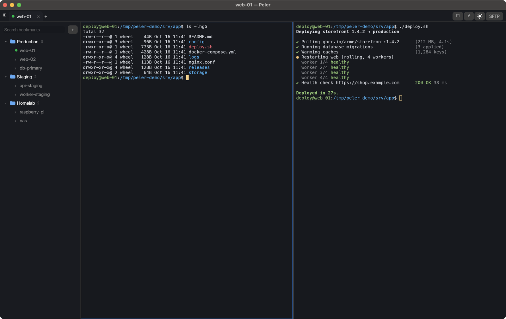
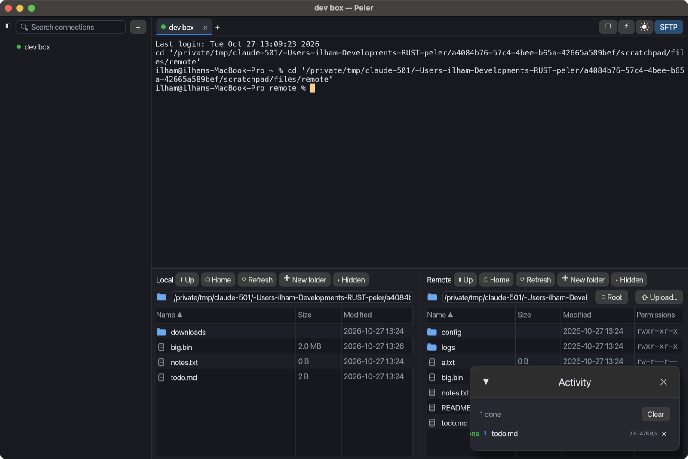
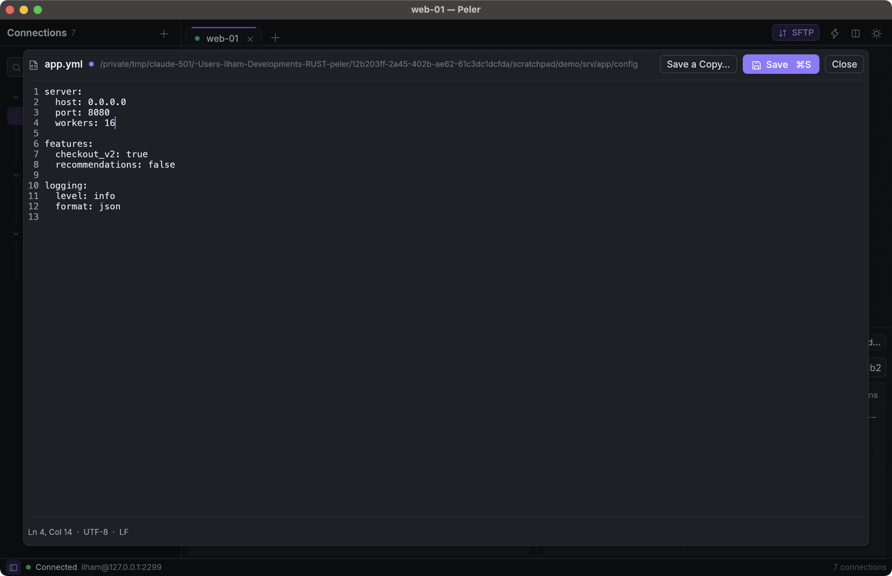

# Peler

**A lightweight SSH & SFTP client for macOS, written entirely in Rust.**

Peler is a native replacement for Electron-based SSH clients such as Electerm: one small universal
binary (Apple Silicon + Intel), no Chromium, no Node.js. It starts in about 0.1 s, idles at 0 % CPU
and uses around 70 MB of memory with a session open.

[Bahasa Indonesia](README.id.md)



## Highlights

- **Saved connections** in nested groups, with drag and drop, fuzzy search and `⌘K` quick connect.
  Passwords and passphrases live in the **macOS Keychain**, never in a file.
- **A real terminal** (alacritty_terminal): 24-bit colour, mouse reporting for vim/htop/tmux, IME,
  CJK, and box drawing drawn pixel-exact.
- **Tabs and split panes** that share one SSH connection.
- **Dual-pane SFTP**: transfer many files at once in the background, with progress, speed and time
  left. Folders transfer recursively, and permissions are kept.
- **Built-in editor for remote files**: change a YAML config on the server and press `⌘S`.
- **Import** from Electerm and `~/.ssh/config`. **Export** to versioned JSON, with optional encrypted
  credentials.
- **Careful with your servers**: strict host-key checking (hashed `known_hosts`, `@revoked`), safe
  saves, and transfers that never leave half-written files behind.
- **Automatic updates** from GitHub releases, with one click to install.
- English and Indonesian UI, light and dark themes, no telemetry.

## Install

Requires macOS 12 Monterey or later, on Apple Silicon or Intel.

### One-line installer (recommended)

```sh
curl -fsSL https://raw.githubusercontent.com/ilhamnadhif/peler/master/scripts/install.sh | bash
```

The script downloads the latest release, installs `Peler.app` into `/Applications`, and opens it.
Run it again to update. To install a specific version, pass it as an argument:
`… | bash -s -- v1.0.0`.

### Installer package or disk image

Download one of these from the [latest release](https://github.com/ilhamnadhif/peler/releases/latest):

- **`Peler-<version>.pkg`**: a regular macOS installer that puts Peler in `/Applications`.
- **`Peler-<version>.dmg`**: open it and drag **Peler** onto **Applications**.

> **First launch.** Release builds are not yet signed with an Apple Developer ID, so Gatekeeper
> blocks files downloaded with a browser. Right-click the `.pkg` (or `Peler.app`) → **Open** →
> **Open** once. Or clear the quarantine flag:
> `xattr -dr com.apple.quarantine /Applications/Peler.app`.
> The one-line installer avoids this step.

### Homebrew

Each release includes a cask file, `peler.rb`:

```sh
curl -fsSLO https://github.com/ilhamnadhif/peler/releases/latest/download/peler.rb
brew install --cask ./peler.rb
```

### Automatic updates

Peler checks GitHub for a new release when it starts and once a day. When one is out, an
**Update** button appears in the toolbar. **Install and Restart** then:

1. downloads the new version and verifies it (size, the SHA-256 GitHub publishes, bundle id,
   version and code signature);
2. quits Peler, replaces the app, and opens the new version.

If Peler was installed with the `.pkg` (the app is then owned by root), macOS asks for an
administrator password. You can also use **Peler → Check for Updates…**, skip a version, or turn
automatic checks off in **Settings → General**. The update check is the only connection Peler
makes besides your own servers.

Version 1.0.0 has no updater; install the next version by hand once.

### Uninstall

```sh
rm -rf /Applications/Peler.app
rm -rf ~/Library/Application\ Support/peler      # connections, settings, known hosts
```

Saved passwords are Keychain items with the service name `peler`; remove them in Keychain Access.

## Features

### Connections

- Name, host, port, user, group, tags, notes, remote and local start folders, startup commands, and
  legacy algorithms per server.
- Log in with a password or a private key. **Paste the key** (OpenSSH or PEM; RSA, ECDSA or
  Ed25519, encrypted or not), and Peler checks it as you paste and keeps it in the Keychain. Or
  point to a key file in `~/.ssh`.
- Nested groups; drag and drop to reorder or regroup.
- Fuzzy search over name, host, user, tags and group. Press Enter to connect.
- `⌘K` opens a command palette. Typing `user@host:port` there (IPv6 as `[::1]:22`) connects without
  a saved connection.
- Open from the command line: `open -a Peler --args web-01` or `--args deploy@10.0.0.5:2222`.
  Peler runs as a single instance: launching it again opens the tab in the window that is already
  open.

### Terminal

- xterm-256color emulation, 24-bit colour, scrollback (10,000 lines by default), alternate screen,
  bracketed paste, mouse reporting, focus events, and DEC 2026 synchronized output.
- Selection: double-click selects a word, triple-click a line, Option-drag a block. Copy on select is
  optional.
- Box drawing and block characters are drawn as shapes, so lines join seamlessly. CJK fallback fonts
  are memory-mapped.
- IME composition, with the candidate window at the cursor.
- Password, keyboard-interactive (one-time codes) and Ed25519 / ECDSA / RSA key authentication,
  including encrypted keys.
- Tabs and split panes (`⌘D`, `⇧⌘D`) over one connection. A split opens in the current remote
  folder when the shell reports it.
- Enter in an ended pane starts a new shell there; `⌘R` reconnects the whole tab and keeps its
  scrollback.
- Option as Meta (optional) for readline and Emacs. It works with any keyboard layout, and only
  while a terminal has focus.
- Quick commands (⚡), nine colour schemes, and a choice of fonts (or your own font file).

### SFTP (`⇧⌘F`)



- Local and remote lists side by side, over the same SSH connection.
- **Upload, download, rename, delete (recursive), new folder, chmod.**
- **Many files at once**: select with ⌘-click, ⇧-click or `⌘A` over a list, then use
  **Upload (n)** / **Download (n)** under the lists. **Upload…** opens the macOS file picker, and you
  can also drag between the lists or drop files from Finder.
- **Transfers you can follow**: the transfer list (resizable and collapsible) shows the whole batch:
  files done, percent, size, speed and time left. Each row shows its own progress. While the panel
  is hidden, the tab shows a progress ring and the toolbar shows **SFTP ⬆ 45%**. A notification tells
  you when everything has finished or something failed.
- Files are written under a temporary name and renamed into place when complete. Cancelling, closing
  the tab or quitting removes partial files, on the server too. Sizes are verified, and permissions
  and the executable bit are kept.
- You are asked before an existing file is overwritten.

### Remote file editor



Double-click a remote file (or right-click → **Edit**) to edit it in place:

- Line numbers, cursor position, `⌘S` to save, `Esc` to close.
- Tab inserts spaces (YAML does not allow tabs), and Enter keeps the indentation.
- CRLF/LF line endings, a UTF-8 BOM and file permissions are preserved.
- **Safe saves**: the new content is written next to the file and swapped in, so a dropped
  connection never leaves a half-written config. Symlinks and files owned by other users are
  written in place.
- Warns if someone changed the file since you opened it. Asks before discarding unsaved changes,
  including on closing the tab or quitting.
- Binary files and files over 2 MB are not opened; you can download them instead.

### Import and export

- **Export** all connections, a group, or a selection to versioned JSON (`schema_version`,
  `exported_at`, `groups`, `bookmarks`).
- Credentials are **not** exported unless you ask. If you do, they are encrypted with a passphrase
  (Argon2id 64 MiB + XChaCha20-Poly1305) and bound to their host, port and user. If someone edits the
  connection list in the file to point elsewhere, the credentials are not imported.
- **Import** shows a preview of what will be added, updated or skipped. Each conflict can be
  skipped, overwritten or kept as both. Importing the same file twice changes nothing. Startup
  commands from a file are imported only if you opt in.
- **Electerm** exports (connections with nested groups, passwords and pasted keys) and
  **`~/.ssh/config`** (`Host`, `HostName`, `Port`, `User`, `IdentityFile`, `Host *`, negation,
  `Include`).

## Keyboard shortcuts

| Action | Shortcut |
| --- | --- |
| Quick connect / search connections | `⌘K` |
| New connection | `⌘N` |
| New tab (same server) | `⌘T` |
| Close pane / tab | `⌘W` |
| Switch tab | `⌘1`–`⌘9`, `⇧⌘[` / `⇧⌘]` |
| Reconnect | `⌘R` |
| Split right / down | `⌘D` / `⇧⌘D` |
| Previous / next pane | `⌘[` / `⌘]` |
| Sidebar | `⌘B` |
| SFTP panel | `⇧⌘F` |
| Text size | `⌘=` / `⌘-` / `⌘0` |
| Clear scrollback | `⌥⌘K` |
| Scroll history | `⇧PageUp` / `⇧PageDown` / `⇧Home` / `⇧End` |
| Export connections | `⇧⌘E` |
| Settings | `⌘,` |
| Save (remote file editor) | `⌘S` |

## Performance

Measured on an Apple Silicon MacBook running macOS 14.6, with the release build:

| | Result |
| --- | --- |
| Memory, 1 SSH session | 68 MB (physical footprint, as in Activity Monitor) |
| Memory, 5 SSH tabs | 78 MB |
| Cold start to first frame | ~0.1 s |
| Universal `.app` (arm64 + x86_64) | 28 MB (DMG 15 MB) |
| CPU when idle | 0.0 % |
| SFTP, 1 GiB to a local sshd | ~640 MB/s up, ~650–700 MB/s down, sha256 verified |

Scrollback costs about 24 bytes per cell. Five tabs, each with a full 10,000-line, 120-column
history, add up to about 210 MB. Lower **Scrollback** in Settings if you keep many busy tabs open.

## Security and data

| What | Where |
| --- | --- |
| Connections | `~/Library/Application Support/peler/bookmarks.json` (mode 0600) |
| Settings (including window size and position) | `~/Library/Application Support/peler/settings.json` |
| Trusted host keys | `~/Library/Application Support/peler/known_hosts` |
| Passwords, passphrases, imported keys | macOS Keychain, service `peler` |
| Crash reports | `~/Library/Logs/Peler/panic-*.log` |

- **Host keys**: Peler checks the app's own `known_hosts` and, read-only, `~/.ssh/known_hosts`,
  including hashed entries, wildcards, negation and `@revoked`.
  - A new host must be trusted with a click; Enter never accepts a key.
  - A changed key, or a key of a different type than the one on record, triggers a red warning that
    shows the old fingerprints.
  - Revoked keys are refused.
- **Algorithms**: AES-256-GCM is preferred (hardware AES, via *ring*), then ChaCha20-Poly1305.
  SHA-1 signatures, CBC ciphers and SHA-1 key exchange are only enabled when **Legacy algorithms**
  is ticked for a connection.
- **Files** are written atomically (unique temp file, `fsync`, rename). An unreadable connections or
  settings file is set aside as `*.corrupt-<time>.json`, never overwritten. A connections file from a
  newer version is never touched.
- **Secrets** are only offered for saving for stored connections. Switching a connection's login method
  removes secrets it no longer uses. Nothing secret is logged, and there is no telemetry.

## Building from source

Requires the Rust stable toolchain (via [rustup](https://rustup.rs)) and the Xcode Command Line
Tools.

```sh
git clone https://github.com/ilhamnadhif/peler.git && cd peler
cargo run --release                       # build and run
cargo run --release -- web-01             # open a saved connection (or user@host[:port])
scripts/package.sh                        # universal Peler.app, .dmg, .pkg and Homebrew cask in dist/
PELER_ARCHS=aarch64 scripts/package.sh    # Apple Silicon only (faster)
```

### Releasing a new version

```sh
scripts/release.sh 1.1.0              # release notes generated from the commits
scripts/release.sh 1.1.0 notes.md     # or written by you
```

The script runs these steps in order:

1. bumps the version in `Cargo.toml`;
2. runs the tests;
3. builds the universal app with its `.dmg`, `.pkg`, `.zip` and Homebrew cask;
4. commits and tags `v1.1.0`, and pushes;
5. publishes the GitHub release with the files attached.

Installed copies pick it up on their next check. It needs the GitHub CLI (`gh auth login`) and a
clean working tree.

### Signing and notarization

With an Apple Developer account:

```sh
xcrun notarytool store-credentials peler-notary --apple-id <email> --team-id <TEAMID>   # once

PELER_SIGN_IDENTITY="Developer ID Application: Your Name (TEAMID)" \
PELER_INSTALLER_IDENTITY="Developer ID Installer: Your Name (TEAMID)" \
PELER_NOTARY_PROFILE=peler-notary scripts/package.sh
```

The script signs with the hardened runtime, then notarizes and staples both the DMG and the package.

## Testing

```sh
cargo test                                                   # unit + integration tests
cargo test --release --test sftp_integration -- --ignored    # 1 GiB round trip with sha256
cargo audit                                                  # dependency advisories
```

The integration tests start macOS's own OpenSSH `sshd` unprivileged on a random port. They cover:

- key authentication, and host keys that are new, changed or revoked;
- shells, resizing and several panes;
- SFTP transfers and the remote editor.

An in-process SSH server covers the password and keyboard-interactive flows.

Debug builds include an end-to-end driver. It sends real keyboard and mouse events to the window,
through the same path as user input (menu, winit, egui):

```sh
PELER_DATA_DIR=/tmp/peler-e2e PELER_SECRETS=memory \
PELER_DEV_SCRIPT='sleep 1500;; connect local dev;; sleep 2500;; keys echo hi\r;; expect-screen hi;; key cmd+d;; expect-panes 2;; quit' \
  target/debug/peler
```

Results are printed as `DEVTEST PASS/FAIL` lines. `PELER_DATA_DIR` and `PELER_SECRETS` only work in
debug builds. `scripts/dev-sshd.sh` starts a local sshd to try the app against.

## Project layout

```
src/
  app.rs              application: layout, tabs, actions, dialogs
  bookmarks/          model, store, fuzzy search, import/export, Electerm, ~/.ssh/config
  ssh/                russh connection, authentication, known_hosts, shells
  sftp/               remote operations, background transfers, editor load/save
  term/               terminal core (alacritty_terminal), key/mouse encoding, colour schemes
  ui/                 terminal widget, sidebar, editors, dialogs, SFTP panel, menu, fonts
  crypto.rs           export encryption
  secrets.rs          Keychain
  i18n.rs             English/Indonesian strings (a test checks every UI string is translated)
  instance.rs         single instance and argument forwarding
  update.rs           update check, download, verification and install
tests/                integration tests (local sshd, in-process server, 1 GiB SFTP)
scripts/              package.sh, release.sh, install.sh, dev-sshd.sh
```

Built with [egui](https://github.com/emilk/egui) (wgpu/Metal),
[alacritty_terminal](https://github.com/alacritty/alacritty),
[russh](https://github.com/Eugeny/russh) and russh-sftp, [tokio](https://tokio.rs) and
[keyring](https://github.com/hwchen/keyring-rs).

## Known limitations

- Release builds are not signed with an Apple Developer ID yet. See *First launch* above.
- Not covered by the automated tests, so worth a manual check: IME composition, reordering connections
  by drag and drop, and files dropped from Finder.
- Files dropped from Finder upload to the remote folder that is open; macOS does not report where
  in the window they were dropped.
- `cargo audit` reports RUSTSEC-2023-0071, a timing side channel in the `rsa` crate that russh uses
  for RSA keys. There is no fixed version yet. The risk is low for a client that only signs locally
  with your own key; prefer Ed25519 keys.
- Not yet available: port forwarding, ProxyJump, ssh-agent, and Linux/Windows builds.

## License

[MIT](LICENSE) © 2026 ilhamnadhif
