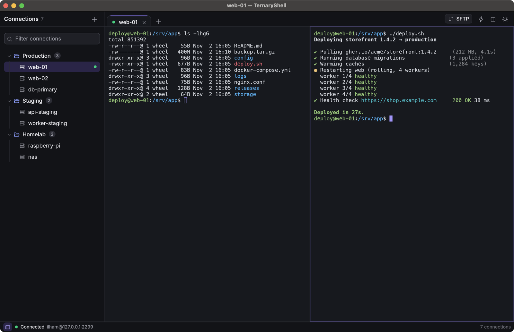
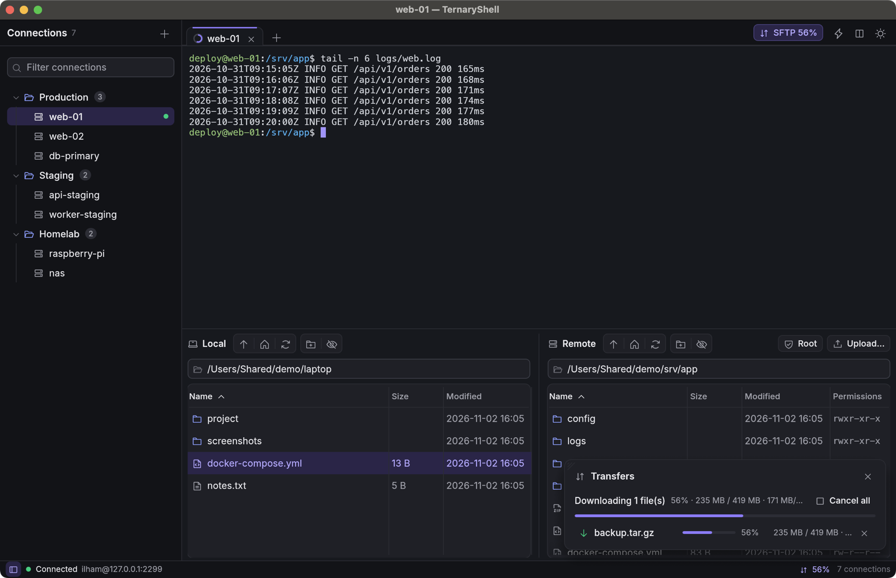
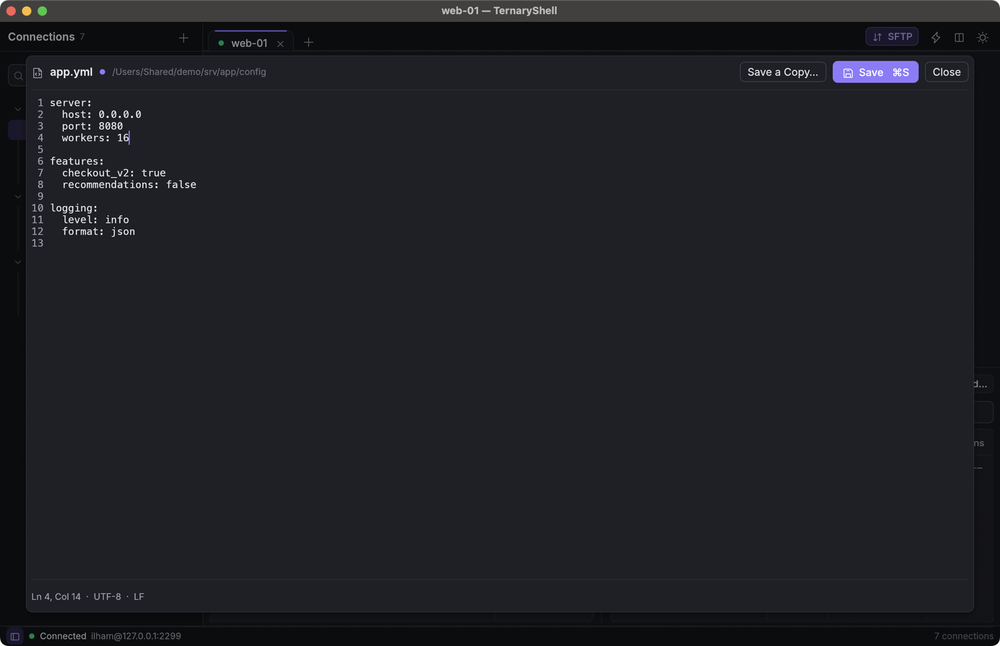

# TernaryShell

**A lightweight SSH & SFTP client for macOS, Windows and Linux, written entirely in Rust.**

TernaryShell is a native replacement for Electron-based SSH clients such as Electerm: one small binary,
no Chromium, no Node.js. It starts in about 0.1 s, idles at 0 % CPU and uses around 70 MB of
memory with a session open.

[Bahasa Indonesia](README.id.md)



## Highlights

- **Saved connections** in nested groups, with drag and drop, fuzzy search and quick connect
  (`⌘K`, `Ctrl+Shift+K` on Windows and Linux). Passwords and passphrases live in the system's
  keychain (the macOS Keychain, Windows Credential Manager, the Secret Service on Linux), not in
  TernaryShell's files. **Show** in Edit
  Connection reveals a saved one.
- **A real terminal** (alacritty_terminal): 24-bit colour, mouse reporting for vim/htop/tmux, IME,
  CJK, and box drawing drawn pixel-exact.
- **Tabs and split panes** that share one SSH connection.
- **Notices dead connections**: after the network changes (a VPN turned on or off, another Wi-Fi,
  waking from sleep), or when typed keys get no reply, TernaryShell checks the server. A connection that
  no longer answers says so within seconds and offers **Reconnect**, instead of hanging.
- **Dual-pane SFTP**: transfer many files at once in the background, with progress, speed and time
  left. Folders transfer recursively, permissions are kept, and you can browse as root over sudo.
- **Built-in editor for remote files**: change a YAML config on the server and press `⌘S` (`Ctrl+S`).
- **Import** from Electerm and `~/.ssh/config`. **Export** to versioned JSON with the passwords and
  keys included, to move everything to another computer, on any of the three systems.
- **Careful with your servers**: strict host-key checking (hashed `known_hosts`, `@revoked`), safe
  saves, and transfers that never leave half-written files behind.
- **Automatic updates** from GitHub releases, with one click to install.
- **macOS, Windows and Linux**, each with its own installers and shortcuts.
- English and Indonesian UI, light and dark themes, no telemetry.

## Install

Download from the [latest release](https://github.com/ilhamnadhif/ternaryshell/releases/latest):

| System | Download |
| --- | --- |
| macOS 12 Monterey or later (Apple Silicon, Intel) | one-line installer below, `TernaryShell-<version>.pkg` or `.dmg` |
| Windows 10 (1809) or later, x64 | `TernaryShell-<version>-windows-x64-setup.exe`, or the portable `-windows-x64.zip` |
| Debian, Ubuntu, Mint, Pop!_OS | `TernaryShell-<version>-linux-amd64.deb` (`-arm64.deb` on ARM) |
| Fedora, RHEL, Rocky, AlmaLinux, openSUSE | `TernaryShell-<version>-linux-x86_64.rpm` (`-aarch64.rpm`) |
| Any Linux (Arch, Manjaro …) | `TernaryShell-<version>-linux-x86_64.AppImage` or `.tar.gz` (`-aarch64` on ARM) |

### macOS

#### One-line installer (recommended)

```sh
curl -fsSL https://raw.githubusercontent.com/ilhamnadhif/ternaryshell/master/scripts/install.sh | bash
```

The script downloads the latest release, installs `TernaryShell.app` into `/Applications`, and opens it.
Run it again to update. To install a specific version, pass it as an argument:
`… | bash -s -- v1.4.2`.

#### Installer package or disk image

Download one of these from the [latest release](https://github.com/ilhamnadhif/ternaryshell/releases/latest):

- **`TernaryShell-<version>.pkg`**: a regular macOS installer that puts TernaryShell in `/Applications`.
- **`TernaryShell-<version>.dmg`**: open it and drag **TernaryShell** onto **Applications**.

> **“TernaryShell” Not Opened / “Apple could not verify…”?** Release builds are not notarized by Apple
> yet, so macOS blocks apps and installers downloaded with a browser. Since macOS 15, the old
> right-click → Open trick no longer works. Do one of these:
>
> - **Use the one-line installer** above. Nothing downloaded with `curl` is blocked.
> - **Allow it once in Settings**: click **Done** in the warning, open **System Settings → Privacy &
>   Security**, scroll down to **Security**, and click **Open Anyway** next to “TernaryShell was blocked…”.
>   Confirm with your password, then open TernaryShell (or the `.pkg`) again.
> - **Or in Terminal**, after dragging the app to Applications:
>   `xattr -dr com.apple.quarantine /Applications/TernaryShell.app`

#### Homebrew

Each release includes a cask file, `ternaryshell.rb`:

```sh
curl -fsSLO https://github.com/ilhamnadhif/ternaryshell/releases/latest/download/ternaryshell.rb
brew install --cask ./ternaryshell.rb
xattr -dr com.apple.quarantine /Applications/TernaryShell.app   # until releases are notarized
```

### Windows

Run **`TernaryShell-<version>-windows-x64-setup.exe`**. It installs for your user, without administrator
rights (choose **Install for all users** in its first window to put TernaryShell in Program Files), adds
TernaryShell to the Start menu, and can put `ternaryshell` on the PATH so `ternaryshell web-01` opens a saved connection
from a terminal. Or unpack the portable **`.zip`** anywhere and run `ternaryshell.exe`.

> **“Windows protected your PC”?** The builds are not code-signed yet, so SmartScreen warns about a
> new download. Click **More info**, then **Run anyway**.

### Linux

TernaryShell runs on X11 and Wayland with OpenGL (a software renderer is fine) and needs glibc 2.28 or
later (RHEL 8, Debian 10, Ubuntu 18.10 and newer). Saved passwords go to the Secret Service
(GNOME Keyring, KWallet, KeePassXC); file dialogs use the desktop portal.

```sh
sudo apt install ./TernaryShell-<version>-linux-amd64.deb              # Debian, Ubuntu, Mint, Pop!_OS
sudo dnf install ./TernaryShell-<version>-linux-x86_64.rpm             # Fedora, RHEL, Rocky, AlmaLinux
sudo zypper install --allow-unsigned-rpm ./TernaryShell-<version>-linux-x86_64.rpm   # openSUSE
chmod +x TernaryShell-<version>-linux-x86_64.AppImage && ./TernaryShell-<version>-linux-x86_64.AppImage
tar -xzf TernaryShell-<version>-linux-x86_64.tar.gz -C ~/.local --strip-components=1   # then run: ternaryshell
```

The `.tar.gz` unpacks into `~/.local` as it is (`bin/ternaryshell`, its menu entry and icons).

### Automatic updates

Every time TernaryShell starts, it checks GitHub for a new release. When one is out, the update window
opens with the current and new version and what's new. **Install Update** then downloads the
latest version, even one released after the window opened (so 1.2.3 goes straight to the newest,
never one version at a time), verifies it (its size and the SHA-256 GitHub publishes, plus what
each system allows), quits TernaryShell and installs it:

- **macOS**: checks the bundle id, version and code signature, replaces the app and opens the new
  version. If TernaryShell was installed with the `.pkg` (the app is then owned by root), macOS asks for
  an administrator password.
- **Windows** (installed with the setup): runs the new setup silently over the installed version,
  then opens TernaryShell again. An installation for all users asks for administrator rights.
- **Linux AppImage and `.tar.gz`**: checks that the new version runs, puts it in place and opens it.
- **The `.deb`, `.rpm` and the portable Windows `.zip`** are updated by downloading the new
  package from GitHub (the update window says so and opens the page).

**Close** asks again at the next start; tick **Don't show again for version …** to skip that
version. While TernaryShell stays open it checks again every 6 hours and shows an **Update** button in
the toolbar instead of interrupting you. You can also use **Check for Updates…** (in the **TernaryShell**
menu on macOS, in the **☰** menu elsewhere), or turn automatic checks off in **Settings → General**.
The update check is the only connection TernaryShell makes besides your own servers.

### Uninstall

| System | Remove |
| --- | --- |
| macOS | `rm -rf /Applications/TernaryShell.app ~/Library/Application\ Support/ternaryshell`; saved passwords are Keychain items named `ternaryshell` |
| Windows | **Settings → Apps → TernaryShell → Uninstall**; then delete `%APPDATA%\ternaryshell`; saved passwords are in Credential Manager (`ternaryshell`) |
| Linux | `sudo apt remove ternaryshell` / `sudo dnf remove ternaryshell`, or delete the AppImage or `~/.local/bin/ternaryshell`; then `rm -rf ~/.local/share/ternaryshell` |

The data folder holds the connections, settings and known hosts.

## Features

### Connections

- Name, host, port, user, group, tags, notes, remote and local start folders, startup commands, and
  legacy algorithms per server.
- Log in with a password or a private key. **Paste the key** (OpenSSH or PEM; RSA, ECDSA or
  Ed25519, encrypted or not), and TernaryShell checks it as you paste and keeps it in the system's keychain. Or
  point to a key file in `~/.ssh`.
- **SSH agent**: log in with the keys of the system agent (`ssh-add`), 1Password, Secretive,
  Bitwarden, GNOME Keyring or a YubiKey agent; on Windows the OpenSSH agent or Pageant. The agent
  signs; the keys never leave it. TernaryShell finds the usual agents by itself.
- **Jump hosts** (`ssh -J`): reach a server through another saved connection, also several in a
  row. Each hop checks its own host key and logs in with its own method.
- **Port forwarding** per connection, started when it connects: local (`-L`), remote (`-R`) and a
  SOCKS proxy (`-D`). The status bar shows the forwards and says when a port is already in use.
- Nested groups, closed when TernaryShell opens; drag and drop to reorder or regroup.
- Fuzzy search over name, host, user, tags and group. Press Enter to connect.
- `⌘K` (`Ctrl+Shift+K`) opens a command palette. Typing `user@host:port` there (IPv6 as `[::1]:22`) connects without
  a saved connection.
- Open from the command line: `open -a TernaryShell --args web-01` or `--args deploy@10.0.0.5:2222`.
  TernaryShell runs as a single instance: launching it again opens the tab in the window that is already
  open.

### Terminal

- xterm-256color emulation, 24-bit colour, scrollback (10,000 lines by default), alternate screen,
  bracketed paste, mouse reporting, focus events, and DEC 2026 synchronized output.
- Selection: double-click selects a word, triple-click a line, Option-drag (Alt-drag) a block. Copy on select is
  optional.
- Box drawing and block characters are drawn as shapes, so lines join seamlessly. CJK fallback fonts
  are memory-mapped.
- IME composition, with the candidate window at the cursor.
- Password, keyboard-interactive (one-time codes) and Ed25519 / ECDSA / RSA key authentication,
  including encrypted keys.
- Tabs and split panes (`⌘D`, `⇧⌘D`; `Ctrl+Shift+D`, `Ctrl+Alt+Shift+D`) over one connection. A split opens in the current remote
  folder when the shell reports it.
- Enter in an ended pane starts a new shell there; `⌘R` (`Ctrl+Shift+R`) reconnects the whole tab and keeps its
  scrollback.
- Option as Meta on macOS (optional) and Alt as Meta on Windows and Linux, for readline and Emacs. It works with any keyboard layout, and only
  while a terminal has focus.
- Quick commands (the lightning button), nine colour schemes, and a choice of fonts (or your own
  font file).

### SFTP (`⇧⌘F`, `Ctrl+Shift+F`)



- Local and remote lists side by side, over the same SSH connection. Each side has two button
  groups (**Up**, **Home**, **Refresh**, then **New folder** and **Show hidden files**) and a
  full-width path field; the lists run to the bottom of the panel.
- **Upload, download, rename, delete (recursive), new folder, chmod.**
- **Many files at once**: select with ⌘-click (Ctrl-click), ⇧-click or `⌘A` (`Ctrl+A`) over a list,
  then drag between the lists, drop files from Finder or Explorer, or use the right-click menu.
  **Upload…** on the remote side opens the system's file picker.
- **Browse as root (sudo)**: the **Root** button on the remote side reopens the file panel as root
  through `sudo`, to see and transfer files your user has no access to. It asks for the sudo password
  (or leave it empty for passwordless sudo); the terminal stays as your user. The server must allow
  sudo for your user. Click **Root** again to go back.
- **Transfers you can follow**: a floating popup (which you can hide or close) shows the whole batch:
  files done, percent, size, speed and time left, with each row's own progress, and any errors. While
  the panel is hidden, the tab shows a progress ring and the SFTP button shows **SFTP 45%**. A
  notification tells you when everything has finished or something failed.
- Files are written under a temporary name and renamed into place when complete. Cancelling, closing
  the tab or quitting removes partial files, on the server too. Sizes are verified, and permissions
  and the executable bit are kept.
- You are asked before an existing file is overwritten.

### Remote file editor



Double-click a remote file (or right-click → **Edit**) to edit it in place:

- Line numbers, cursor position, `⌘S` (`Ctrl+S`) to save, `Esc` to close.
- Tab inserts spaces (YAML does not allow tabs), and Enter keeps the indentation.
- CRLF/LF line endings, a UTF-8 BOM and file permissions are preserved.
- **Safe saves**: the new content is written next to the file and swapped in, so a dropped
  connection never leaves a half-written config. Symlinks and files owned by other users are
  written in place.
- Warns if someone changed the file since you opened it. Asks before discarding unsaved changes,
  including on closing the tab or quitting.
- Binary files and files over 2 MB are not opened; you can download them instead.

### Import and export

- **Export** all connections, a group, or a selection to versioned JSON (`schema_version`,
  `exported_at`, `groups`, `bookmarks`).
- Saved passwords, passphrases and keys are exported too, including the contents of key files
  (`~/.ssh/...`). They are written **as plain text**, next to each connection (`password`,
  `passphrase`, `private_key`), as Electerm does. Anyone with the file can log in to those
  servers, so keep it safe and delete it once it is imported. The file can only be read by your
  user account.
- On import, a connection keeps its key file on a Mac that has the same file at that path;
  elsewhere its key is kept in the Keychain. Encrypted exports from TernaryShell 1.2.3 and earlier still
  import: enter their passphrase in the import window.
- **Import** shows a preview of what will be added, updated or skipped. Each conflict can be
  skipped, overwritten or kept as both. Importing the same file twice changes nothing. Startup
  commands from a file are imported only if you opt in.
- **Electerm** exports (connections with nested groups, passwords and pasted keys) and
  **`~/.ssh/config`** (`Host`, `HostName`, `Port`, `User`, `IdentityFile`, `IdentityAgent`,
  `ProxyJump`, `LocalForward`, `RemoteForward`, `DynamicForward`, `Host *`, negation, `Include`).

## Keyboard shortcuts

On Windows and Linux the app's shortcuts use **Ctrl+Shift**, as GNOME Terminal and Windows
Terminal do, so Ctrl+C, Ctrl+D, Ctrl+R, Ctrl+W and every other Ctrl+letter still reach the
remote shell. Alt sends Meta (Esc +) there by default; on macOS Option does so when **Use Option
as Meta key** is on in Settings. Every command is also in the menu: the menu bar on macOS, the
**☰** button at the right of the tab bar on Windows and Linux.

| Action | macOS | Windows and Linux |
| --- | --- | --- |
| Quick connect / search connections | `⌘K` | `Ctrl+Shift+K` |
| New connection | `⌘N` | `Ctrl+Shift+N` |
| New tab (same server) | `⌘T` | `Ctrl+Shift+T` |
| Close pane / tab | `⌘W` | `Ctrl+Shift+W` |
| Switch tab | `⌘1`–`⌘9`, `⇧⌘[` / `⇧⌘]` | `Alt+1`–`Alt+9`, `Ctrl+Shift+Tab` / `Ctrl+Tab` (or `Ctrl+PageUp` / `Ctrl+PageDown`) |
| Reconnect | `⌘R` | `Ctrl+Shift+R` |
| Copy / paste | `⌘C` / `⌘V` | `Ctrl+Shift+C` / `Ctrl+Shift+V`; on Windows also `Ctrl+C` while text is selected, and `Ctrl+V` |
| Split right / down | `⌘D` / `⇧⌘D` | `Ctrl+Shift+D` / `Ctrl+Alt+Shift+D` |
| Previous / next pane | `⌘[` / `⌘]` | `Ctrl+Shift+[` / `Ctrl+Shift+]` |
| Sidebar | `⌘B` | `Ctrl+Shift+B` |
| SFTP panel | `⇧⌘F` | `Ctrl+Shift+F` |
| Text size | `⌘=` / `⌘-` / `⌘0` | `Ctrl+=` / `Ctrl+-` / `Ctrl+0` |
| Clear scrollback | `⌥⌘K` | `Ctrl+Shift+L` |
| Scroll history | `⇧PageUp` / `⇧PageDown` / `⇧Home` / `⇧End` | the same |
| Export connections | `⇧⌘E` | `Ctrl+Shift+E` |
| Full screen | `⌃⌘F` | `F11` |
| Settings | `⌘,` | `Ctrl+,` |
| Quit | `⌘Q` | `Ctrl+Shift+Q` |
| Save (remote file editor) | `⌘S` | `Ctrl+S` |

## Performance

Measured on an Apple Silicon MacBook running macOS 14.6, with the release build. On Windows and
Linux TernaryShell draws with OpenGL, which opens a window faster and keeps the binary smaller than
Vulkan or Direct3D (Windows falls back to Direct3D 12 where OpenGL is missing). The Linux binary
is about 16 MB and its packages about 8 MB; on Windows `ternaryshell.exe` is about 21 MB and its installer
8 MB.

| | Result |
| --- | --- |
| Memory, 1 SSH session | 68 MB (physical footprint, as in Activity Monitor) |
| Memory, 5 SSH tabs | 78 MB |
| Cold start to first frame | ~0.1 s |
| Universal `.app` (arm64 + x86_64) | 28 MB (DMG 15 MB) |
| CPU when idle | 0.0 % |
| SFTP, 1 GiB to a local sshd | ~640 MB/s up, ~650–700 MB/s down, sha256 verified |

Scrollback costs about 24 bytes per cell. Five tabs, each with a full 10,000-line, 120-column
history, add up to about 210 MB. Lower **Scrollback** in Settings if you keep many busy tabs open.

## Security and data

| What | macOS | Windows | Linux |
| --- | --- | --- | --- |
| Data folder: connections (`bookmarks.json`), settings, trusted host keys (`known_hosts`) | `~/Library/Application Support/ternaryshell` | `%APPDATA%\ternaryshell` | `~/.local/share/ternaryshell` |
| Passwords, passphrases, imported keys (service `ternaryshell`) | Keychain | Credential Manager | Secret Service (GNOME Keyring, KWallet …) |
| Crash reports (`panic-*.log`) | `~/Library/Logs/TernaryShell` | `%LOCALAPPDATA%\TernaryShell\Logs` | `~/.local/state/ternaryshell/logs` |

Files in the data folder are private to your user (mode 0600 on macOS and Linux; Windows keeps the
user's AppData private).

- **Host keys**: TernaryShell checks the app's own `known_hosts` and, read-only, `~/.ssh/known_hosts`,
  including hashed entries, wildcards, negation and `@revoked`.
  - A new host must be trusted with a click; Enter never accepts a key.
  - A changed key, or a key of a different type than the one on record, triggers a red warning that
    shows the old fingerprints.
  - Revoked keys are refused.
- **Algorithms**: AES-256-GCM is preferred (hardware AES, via *ring*), then ChaCha20-Poly1305.
  SHA-1 signatures, CBC ciphers and SHA-1 key exchange are only enabled when **Legacy algorithms**
  is ticked for a connection.
- **Files** are written atomically (unique temp file, `fsync`, rename). An unreadable connections or
  settings file is set aside as `*.corrupt-<time>.json`, never overwritten. A connections file from a
  newer version is never touched.
- **Secrets** are only offered for saving for stored connections. Switching a connection's login method
  removes secrets it no longer uses. Nothing secret is logged, and there is no telemetry.

## Building from source

Requires the Rust stable toolchain (via [rustup](https://rustup.rs)) and a C compiler: the Xcode
Command Line Tools on macOS, the MSVC build tools on Windows, `gcc` on Linux (no other libraries:
X11, Wayland and OpenGL are loaded at run time).

```sh
git clone https://github.com/ilhamnadhif/ternaryshell.git && cd ternaryshell
cargo run --release                       # build and run
cargo run --release -- web-01             # open a saved connection (or user@host[:port])
scripts/package.sh                        # macOS: universal TernaryShell.app, .dmg, .pkg and Homebrew cask in dist/
TERNARYSHELL_ARCHS=aarch64 scripts/package.sh    # macOS: Apple Silicon only (faster)
scripts/package-linux.sh                  # Linux: .tar.gz, .deb, .rpm and .AppImage in dist/
pwsh scripts/package-windows.ps1          # Windows: setup (Inno Setup 6) and portable .zip in dist/
```

### Releasing a new version

```sh
scripts/release.sh 1.1.0              # release notes generated from the commits
scripts/release.sh 1.1.0 notes.md     # or written by you
```

The script runs these steps in order:

1. bumps the version in `Cargo.toml`;
2. runs the tests;
3. builds the universal macOS app with its `.dmg`, `.pkg`, `.zip` and Homebrew cask;
4. commits, pushes, drafts the GitHub release with the macOS files, and pushes the tag `v1.1.0`;
5. waits while CI (`.github/workflows/ci.yml`) tests on Linux and Windows, builds their packages
   (Linux for x86_64 and aarch64, in an old-glibc build image), installs them on several
   distributions and on Windows, adds them to the release and publishes it.

Installed copies pick it up on their next check. It needs the GitHub CLI (`gh auth login`) and a
clean working tree. CI also runs the tests and lints on Linux and Windows for every push.

### Signing and notarization

With an Apple Developer account:

```sh
xcrun notarytool store-credentials ternaryshell-notary --apple-id <email> --team-id <TEAMID>   # once

TERNARYSHELL_SIGN_IDENTITY="Developer ID Application: Your Name (TEAMID)" \
TERNARYSHELL_INSTALLER_IDENTITY="Developer ID Installer: Your Name (TEAMID)" \
TERNARYSHELL_NOTARY_PROFILE=ternaryshell-notary scripts/package.sh
```

The script signs with the hardened runtime, then notarizes and staples both the DMG and the package.

## Testing

```sh
cargo test                                                   # unit + integration tests
cargo test --release --test sftp_integration -- --ignored    # 1 GiB round trip with sha256
cargo audit                                                  # dependency advisories
```

The integration tests start the system's OpenSSH `sshd` (macOS and Linux) unprivileged on a
random port. They cover:

- key authentication, and host keys that are new, changed or revoked;
- shells, resizing and several panes;
- SFTP transfers and the remote editor.

An in-process SSH server covers the password and keyboard-interactive flows.

Debug builds include an end-to-end driver. On macOS it sends real keyboard and mouse events to the
window, through the same path as user input (menu, winit, egui); elsewhere it runs the actions and
checks only:

```sh
TERNARYSHELL_DATA_DIR=/tmp/ternaryshell-e2e TERNARYSHELL_SECRETS=memory \
TERNARYSHELL_DEV_SCRIPT='sleep 1500;; connect local dev;; sleep 2500;; keys echo hi\r;; expect-screen hi;; key cmd+d;; expect-panes 2;; quit' \
  target/debug/ternaryshell
```

Results are printed as `DEVTEST PASS/FAIL` lines. `TERNARYSHELL_DATA_DIR` and `TERNARYSHELL_SECRETS` only work in
debug builds. `scripts/dev-sshd.sh` starts a local sshd to try the app against.

## Project layout

```
src/
  app.rs              application: layout, tabs, actions, dialogs
  bookmarks/          model, store, fuzzy search, import/export, Electerm, ~/.ssh/config
  ssh/                russh connection, authentication, known_hosts, shells
  sftp/               remote operations, background transfers, editor load/save
  term/               terminal core (alacritty_terminal), key/mouse encoding, colour schemes
  ui/                 terminal widget, sidebar, editors, dialogs, SFTP panel, macOS menu bar,
                      shortcuts (keys.rs), fonts, design tokens (style.rs), components (kit.rs)
  crypto.rs           export encryption
  platform.rs         what differs between macOS, Windows and Linux (opening files, names)
  secrets.rs          Keychain, Credential Manager, Secret Service
  i18n.rs             English/Indonesian strings (a test checks every UI string is translated)
  instance.rs         single instance and argument forwarding
  netwatch.rs         notices network changes (VPN, Wi-Fi, sleep) so connections get checked
  update.rs           update check, download, verification and install
tests/                integration tests (local sshd, in-process server, 1 GiB SFTP)
scripts/              package.sh (macOS), package-linux.sh, package-windows.ps1, release.sh,
                      ci-publish.sh, install.sh, dev-sshd.sh, build-fonts.py
packaging/            Windows installer (Inno Setup) and icon, Linux desktop entry and icons
.github/workflows/    CI: tests on Linux and Windows, packages and publishing for releases
vendor/ssh-key/       ssh-key with a fix for some ECDSA keys (see TERNARYSHELL-PATCH.md there)
```

Built with [egui](https://github.com/emilk/egui) (Metal through wgpu on macOS, OpenGL on Windows and
Linux),
[alacritty_terminal](https://github.com/alacritty/alacritty),
[russh](https://github.com/Eugeny/russh) and russh-sftp, [tokio](https://tokio.rs) and
[keyring](https://github.com/hwchen/keyring-rs).

## Known limitations

- Release builds are not signed and notarized with an Apple Developer ID, nor code-signed for
  Windows, yet: macOS and SmartScreen warn when they are downloaded with a browser; see *Install*.
- On Windows, TernaryShell is built and tested by CI (unit tests, the installer); the end-to-end driver and
  the OpenSSH integration tests run on macOS and Linux.
- Files dragged from the file manager onto the window work on macOS, Windows and X11, not on
  Wayland (not supported by the windowing library yet).
- Not covered by the automated tests, so worth a manual check: IME composition, reordering connections
  by drag and drop, and files dropped from Finder.
- Files dropped from Finder upload to the remote folder that is open; macOS does not report where
  in the window they were dropped.
- RSA logins are signed with `ring` (constant time), not the `rsa` crate that has a timing side
  channel (RUSTSEC-2023-0071, ignored in `.cargo/audit.toml` with the reasons). The `rsa` crate
  still signs in two rare cases: SHA-1 signatures for servers older than 2016 (only with legacy
  algorithms on) and RSA keys shorter than 2048 bits.
- Not yet available: agent forwarding and X11 forwarding.

## License

[MIT](LICENSE) © 2026 ilhamnadhif
